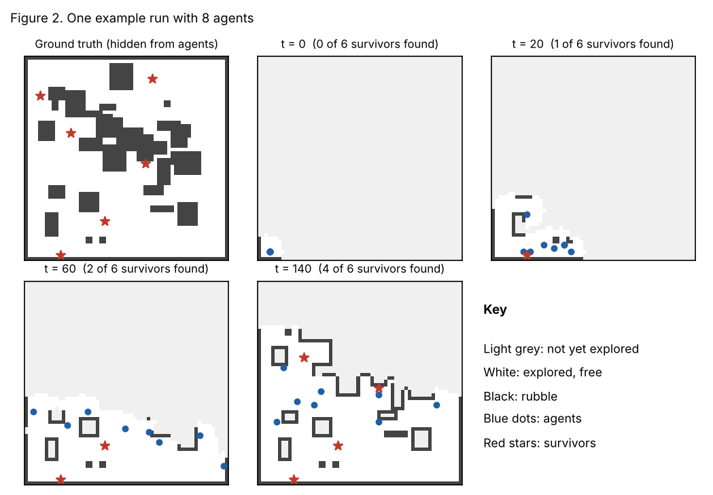
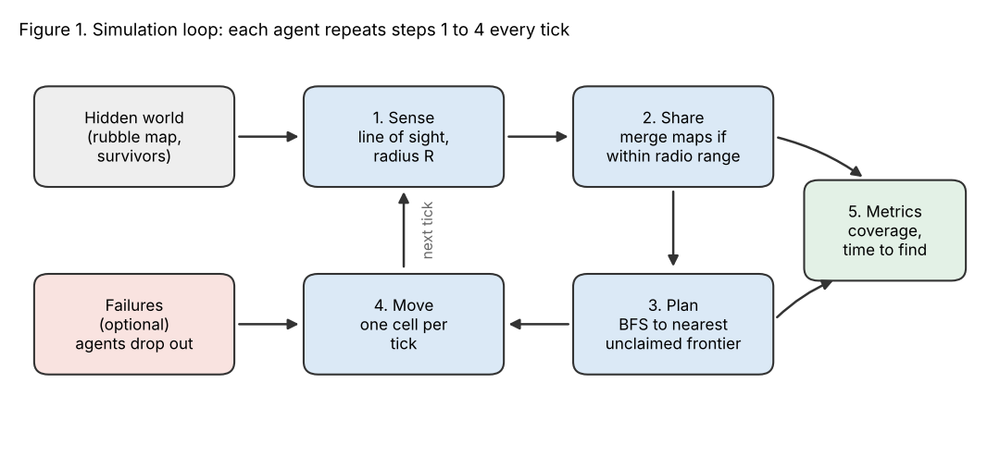
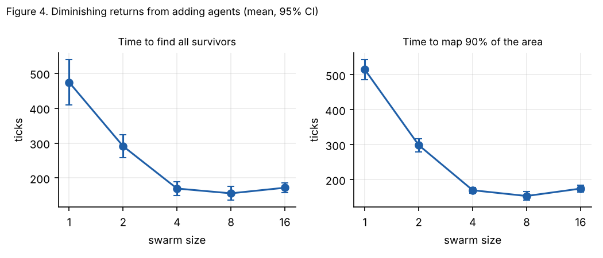

# Swarm Search-and-Rescue Simulation

A small, reproducible simulation of a robot swarm exploring an unknown rubble field to find trapped survivors. Agents share maps only when they are within radio range, so the model captures a core constraint of real search-and-rescue robotics: communication is limited and robots fail.

Everything here is simulated on synthetic data. It is a civilian research and learning project.



## Research questions

1. How does time-to-find-survivors scale with swarm size?
2. How much does limited radio range slow the search?
3. How much does coordination between agents matter?
4. How gracefully does the swarm degrade when agents fail?

## What the model does

- **World:** 60 x 60 grid with random rubble blocks and 6 hidden survivors, all reachable from one entrance.
- **Sensing:** line of sight (rubble blocks the view) out to a radius of 5 cells.
- **Communication:** agents merge maps and survivor sightings only within a fixed radio range (direct sharing, no multi-hop).
- **Planning:** each agent moves toward the nearest unexplored frontier. In the coordinated setting it avoids frontiers already claimed by nearby agents.
- **Failures:** optional random permanent agent failures.



## Main results

Mean over 15 random worlds (ticks, ± approximate 95% CI). Full results and figures are in the [report](report/sar_swarm_report.pdf).

| Swarm size | Ticks to find all survivors |
|---|---|
| 1 | 474 ± 65 |
| 2 | 291 ± 33 |
| 4 | 170 ± 20 |
| 8 | 156 ± 20 |
| 16 | 172 ± 13 |

- **Diminishing returns:** gains flatten beyond about 4 to 8 agents in this world.
- **Symmetry matters:** with no claims and a deterministic planner, 8 identical agents behave exactly like 1 (474 ticks), because they start together and move in lockstep. Claims or random tie-breaking fix this.
- **Radio range:** finding all survivors took about 230 ticks at range 2 and about 139 at range 60.
- **Failures:** low failure rates barely changed results; at 0.01 per agent per tick the swarm found only 86% of survivors on average.



## Quick start

```bash
git clone https://github.com/<your-username>/sar-swarm-simulation.git
cd sar-swarm-simulation
python -m venv .venv && source .venv/bin/activate   # Windows: .venv\Scripts\activate
pip install -r requirements.txt

python sar_swarm_sim.py        # demo run + quick swarm-size check
python sar_experiments.py      # full experiment suite (a few minutes, resumable)
python make_figures.py         # figures and summary statistics
python build_report.py         # PDF report
```

Experiments use fixed random seeds, so results are exactly reproducible.

## Repository layout

| File | Purpose |
|---|---|
| `sar_swarm_sim.py` | The simulator: `run()` plus a quick swarm-size experiment |
| `sar_experiments.py` | Runs every setting on the same worlds and saves raw results |
| `make_figures.py` | Builds the figures and summary statistics |
| `build_report.py` | Assembles the PDF report |
| `figures/` | Figures used in this README |
| `report/` | The full written report |

## Limitations

- 2D grid with random rectangular rubble, not a real collapse, tunnel or cave
- Perfect localisation and noise-free sensing
- Fixed-disc radio with no signal loss through rubble and no multi-hop relaying
- Static survivors, no battery limits, all agents start at one entrance
- Only 15 worlds per setting, so some differences are within the uncertainty

## Ideas for extending it

- Multi-hop relaying and signal loss that depends on rubble
- Localisation error and sensor noise (missed detections and false alarms)
- Measuring congestion and overlap directly
- Other planners (random walk, market-based task assignment)
- 3D or tunnel-network maps, and relay nodes dropped behind the swarm

## Author

Yhoni D Shomron
